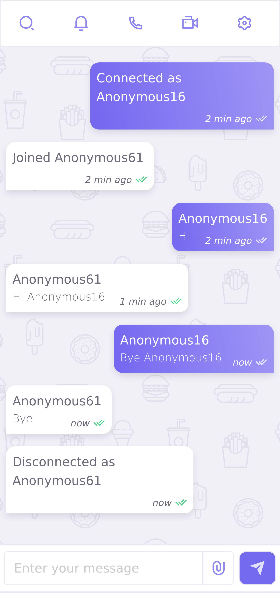

# Vuegram

[](https://www.gnu.org/licenses/gpl-3.0)

Simple WebSocket chat built with Vue.js and aiohttp.




## Getting Started

### Installation
This project uses **uv** for dependency and environment management and targets **Python 3.14+**.

Install uv (once):
```bash
curl -LsSf https://astral.sh/uv/install.sh | sh
```

Sync the project environment from the lock file:
```bash
uv sync --frozen
```

### Usage
Run the aiohttp web server:
```bash
cd vuegram
uv run python main.py
```
Invite multiple users to access your server's IP address (port 8080) through a browser, each will be assigned a random username.

If you need to allow cross-origin WebSocket clients, configure trusted origins explicitly:
```bash
ALLOWED_ORIGINS="https://chat.example.com,https://admin.example.com" uv run python main.py
```

## Development
CI runs on GitHub Actions (`.github/workflows/ci.yml`) and validates the project with Python 3.14 and uv on pull requests and pushes to `main`.

Frontend vendor bundles (`vue.global.js` and `vuex.global.js`) are updated automatically by the scheduled workflow `.github/workflows/update-frontend-vendors.yml` using `scripts/update_frontend_vendors.py`.

## License
This project is licensed under the GNU GENERAL PUBLIC LICENSE
Version 3 - see the [LICENSE](LICENSE) file for details.
